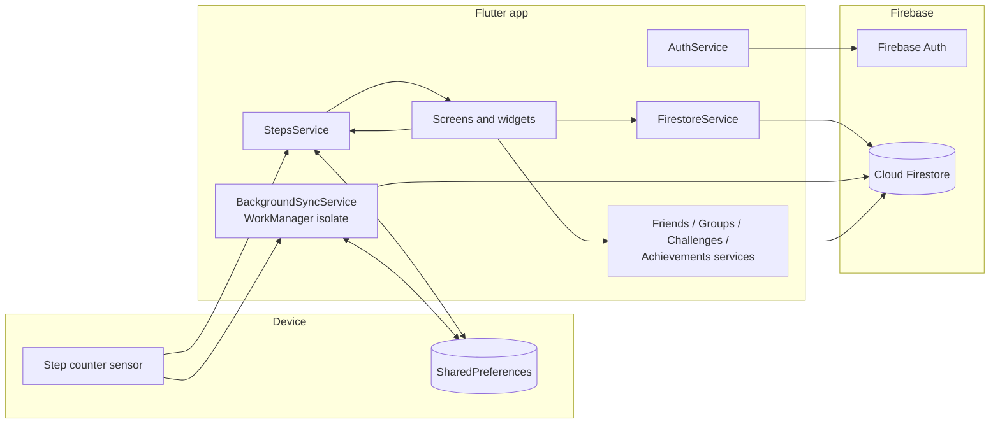

<p align="center">
  
</p>

# Step Buddies

Step Buddies is a social step-tracking app built with Flutter and Firebase. It reads the phone's hardware step counter, turns it into a reliable daily step count, and syncs it to Cloud Firestore, both while the app is open and periodically in the background. On top of that data it adds social features: friend requests, groups with join codes, team challenges over a fixed period, a daily global leaderboard, achievements, and personal statistics. The user-facing app name is "VAGO"; the codebase and package use the working title Step Buddies. The UI is in German.

## Features

- **Step tracking**: daily steps from the device step counter, with handling for midnight resets and phone reboots.
- **Background sync**: periodic upload of the current day's steps via WorkManager (every 15 minutes, network required).
- **Friends**: username search with prefix matching, friend requests (send, accept, decline, cancel), friend-of-friend suggestions, side-by-side comparison with a friend.
- **Groups**: create groups, join via a 6-character code or a shared `stepbuddies://` deep link, per-group leaderboard.
- **Challenges**: team-based challenges with a start date and duration; team scores are summed from members' daily steps in that window and shown as a race track.
- **Global leaderboard**: today's top users; visibility is chosen during onboarding and can be changed in settings.
- **Achievements**: 29 achievements across streaks, goals, step milestones, social, challenge and leaderboard categories, with rarity levels.
- **Statistics**: history of the user's daily steps and goal progress.
- **Time-of-day theming**: dawn, day, dusk and night palettes with animated sky backgrounds (sun/moon, clouds, stars); can be forced to light or dark.

## Architecture

The app follows a simple layered structure: screens and widgets in the UI layer, business logic in service classes (mostly singletons exposed via `Service.instance`), and Firebase as the backend. `ThemeService` is a `ChangeNotifier` provided through `provider`.



### Data model (Cloud Firestore)

| Collection | Document ID | Purpose |
| --- | --- | --- |
| `users` | Firebase Auth UID | Profile, `friendIds`, daily goal, leaderboard opt-in |
| `dailySteps` | `{userId}_{YYYY-MM-DD}` | Step count for one user and day |
| `friendRequests` | auto | `fromUserId`, `toUserId`, `status` (pending, accepted, declined) |
| `groups` | auto | Name, `memberIds`, `joinCode` |
| `challenges` | auto | Title, admin, start date, duration, status, teams with member IDs |
| `userAchievements` | UID | Unlocked achievements |
| `userStats` | UID | Aggregated all-time stats (read by the achievements service) |

Using a deterministic document ID for `dailySteps` makes every write an idempotent upsert, so the foreground app and the background worker can both write the same day without creating duplicates.

### Background sync

`BackgroundSyncService` registers a periodic WorkManager task when the user is signed in. The task runs in a separate isolate: it initializes Firebase, reads the signed-in user ID from `SharedPreferences`, reads the step sensor (with a timeout), applies the same day/reboot logic as the foreground `StepsService`, and merges the result into `dailySteps`. `BackgroundSyncService.stop()` cancels the task and clears the stored user ID.

More detail is in [docs/ARCHITECTURE.md](docs/ARCHITECTURE.md).

## Engineering notes

- **Step counter semantics.** Android's step counter reports cumulative steps since the last boot, not steps per day. The app stores a per-day baseline in `SharedPreferences` and computes `today = current - baseline`. A new baseline is set on first run, when the stored date differs from today, and when the sensor value is lower than the last known value, which indicates a reboot (`lib/services/steps_service.dart`).
- **Shared logic across isolates.** The WorkManager callback cannot use the app's singletons, so the background path re-implements the baseline calculation against the same preference keys to keep both paths consistent (`lib/services/background_sync_service.dart`).
- **Consistent social state.** Accepting a friend request updates the request and both users' `friendIds` inside one Firestore transaction; joining a group by code also uses a transaction.
- **Challenge scoring.** Scores are computed by querying each member's `dailySteps` between the challenge's start (normalized to midnight) and its exclusive end date.
- **Sensor reads with timeouts.** The pedometer stream is wrapped in a `Completer` with a timeout so a missing or silent sensor results in a clear status instead of a hanging future.

## Tech stack

- Flutter (Dart SDK `^3.10.1`), Material 3
- Firebase: Authentication (Google Sign-In), Cloud Firestore
- `pedometer`, `permission_handler`, `workmanager`, `shared_preferences`
- `provider` for theme state, `app_links` and `share_plus` for deep links and sharing
- `intl` for date formatting

## Project structure

```
lib/
  main.dart              App entry, Firebase init, auth/onboarding routing
  firebase_options.dart  Firebase config read from --dart-define values
  services/              Auth, Firestore, steps, background sync, friends, groups,
                         challenges, achievements, deep links
  models/                Challenge, ChallengeTeam, Achievement definitions
  screens/               Home, onboarding, sign-in, friends, groups, challenges,
                         leaderboard, stats, rewards, profile, settings
  widgets/               Progress ring, leaderboard, race track, animated sky, etc.
  theme/                 Time-of-day palettes, spacing, shadows, ThemeService
  l10n/app_strings.dart  Centralized UI strings (German)
docs/ARCHITECTURE.md     Detailed architecture notes
```

## Getting started

### Prerequisites

- Flutter SDK 3.38 or newer on the stable channel (Dart `^3.10.1`)
- An Android device or emulator with a step counter sensor (Android is the primary target; the step-tracking and background-sync paths are built around Android's sensor and WorkManager)
- A Firebase project of your own

### Firebase setup

No Firebase credentials are committed to this repository. To run the app you need your own project:

1. Create a Firebase project and enable **Authentication > Google** and **Cloud Firestore**.
2. Register an Android app with the package name `com.example.step_buddies` and add your debug SHA-1 fingerprint (required for Google Sign-In).
3. Download `google-services.json` and place it at `android/app/google-services.json` (git-ignored). For iOS, place `GoogleService-Info.plist` in `ios/Runner/`.
4. Copy the example environment file and fill in the values from your Firebase project settings:

   ```bash
   cp firebase.env.example.json firebase.env.json
   ```

   `GOOGLE_SERVER_CLIENT_ID` is the OAuth 2.0 **Web client** ID that Firebase creates for Google Sign-In (Google Cloud Console > APIs & Services > Credentials). `firebase.env.json` is git-ignored.

Alternatively, `flutterfire configure` can regenerate `lib/firebase_options.dart` with hard-coded values for your project. If you do this, do not commit the generated file.

Firestore composite indexes (for example on `dailySteps` by `date` and `steps`) are created on demand: the first query that needs one logs a link to create it in the Firebase console.

### Run

```bash
flutter pub get
flutter run --dart-define-from-file=firebase.env.json
```

Without the defines the app compiles but stops at startup with a message explaining that Firebase is not configured.

### Static analysis

```bash
flutter analyze
```

## License

MIT, see [LICENSE](LICENSE).
